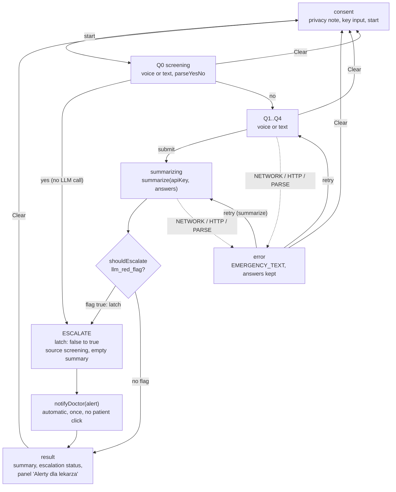
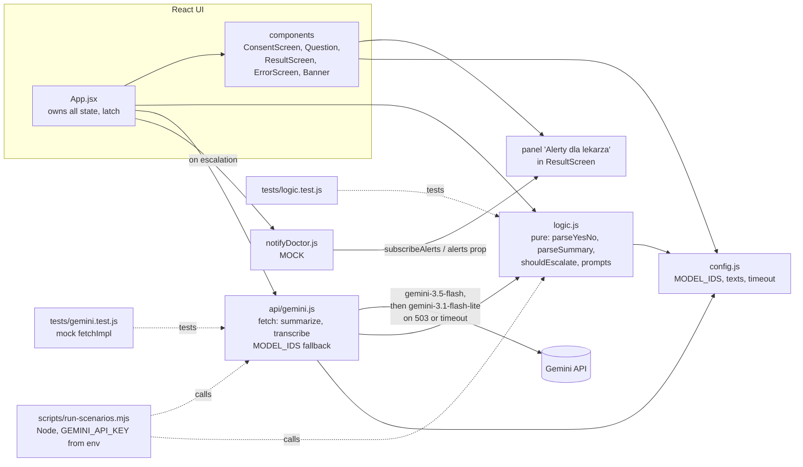
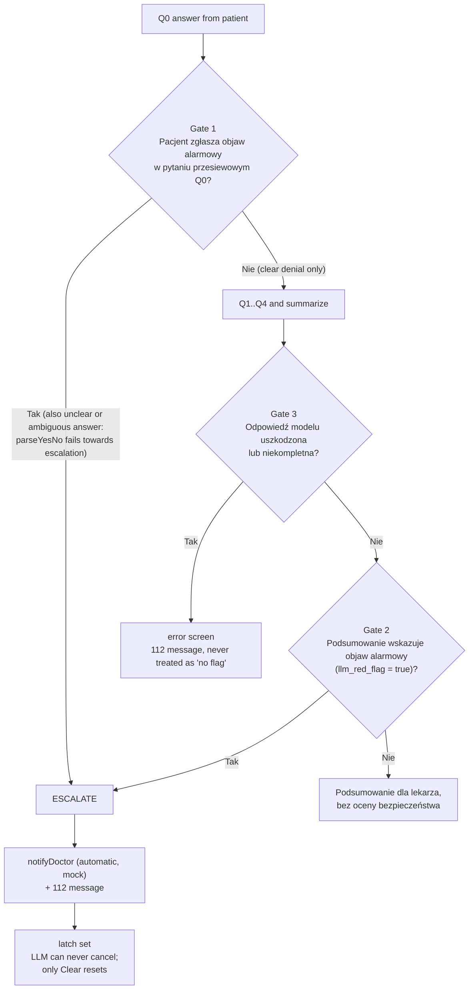

# Architecture diagrams

Visual companion to `architecture.md`. If the two disagree, `architecture.md` wins.

## 1. Flow and state machine

The app moves from consent through the Q0 screening question. A screening "yes" escalates at once with no LLM call; otherwise Q1..Q4 are collected and summarized. Any API failure leads to an error screen with `EMERGENCY_TEXT` and a retry. The escalation latch only goes false to true, and `notifyDoctor` fires automatically on that transition.

## 2. Module diagram

`App.jsx` owns all state and uses pure logic from `logic.js` and the fetch layer in `api/gemini.js`, which falls back between models. The doctor-alert mock feeds the alerts panel. Tests and the scenario script point at the logic and API modules.

## 3. Escalation decision

Escalation is an OR-gate. In every gate, "Tak" (Yes) always means "danger signal present" and "Nie" (No) always means "no signal from this check". Gate 1 asks about the patient's reported symptom in Q0; anything other than a clear denial (unclear or ambiguous answer) counts as a reported symptom, because `parseYesNo` fails towards escalation. Gate 2 asks about the LLM red flag, and only after the summary. If the LLM flag is false, the summary is shown without any "all clear" claim. Gate 3 checks the model response: a malformed or incomplete result is an error screen with the 112 message, never treated as "no flag". Once escalated, nothing in the LLM output can cancel it; only Clear resets the latch.

