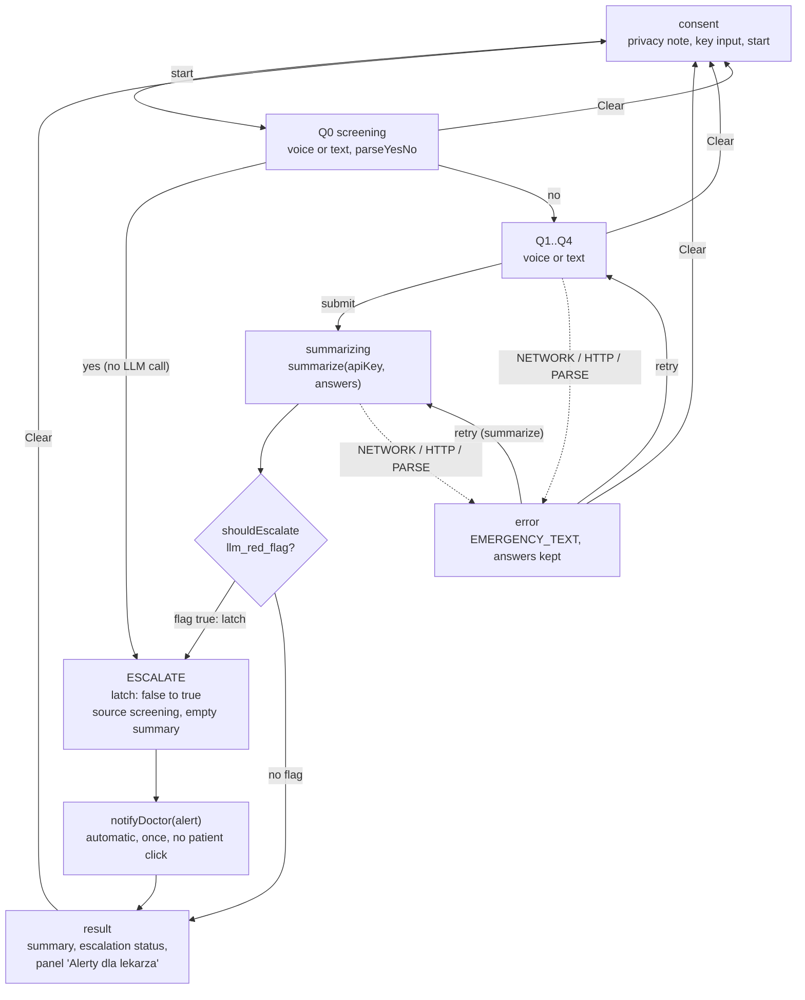
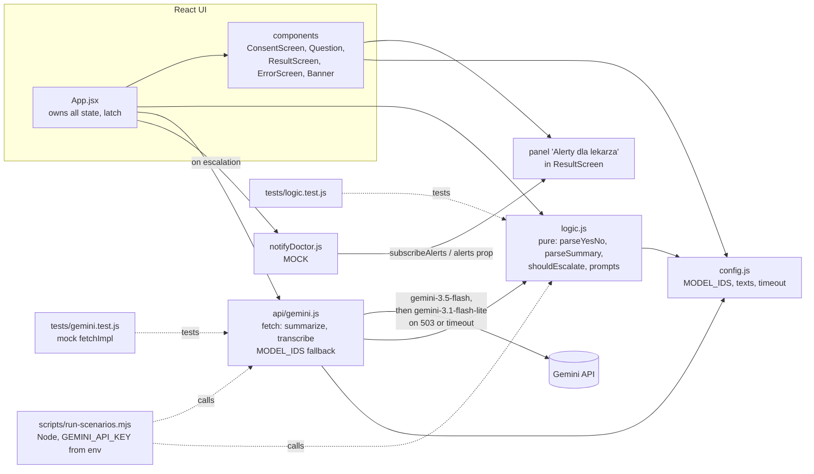
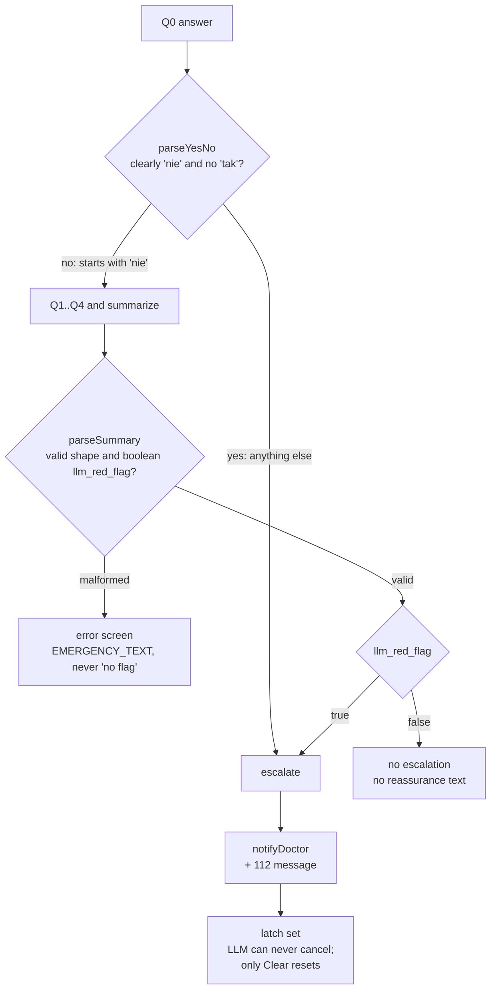

# Architecture diagrams

Visual companion to `architecture.md`. If the two disagree, `architecture.md` wins.

## 1. Flow and state machine

The app moves from consent through the Q0 screening question. A screening "yes" escalates at once with no LLM call; otherwise Q1..Q4 are collected and summarized. Any API failure leads to an error screen with `EMERGENCY_TEXT` and a retry. The escalation latch only goes false to true, and `notifyDoctor` fires automatically on that transition.

## 2. Module diagram

`App.jsx` owns all state and uses pure logic from `logic.js` and the fetch layer in `api/gemini.js`, which falls back between models. The doctor-alert mock feeds the alerts panel. Tests and the scenario script point at the logic and API modules.

## 3. Escalation decision

Escalation is an OR-gate: the Q0 answer (fail-up, anything not clearly "nie" counts as yes) or the LLM red flag. A malformed LLM result is an error, never "no flag". Nothing in the LLM output can cancel an escalation.

